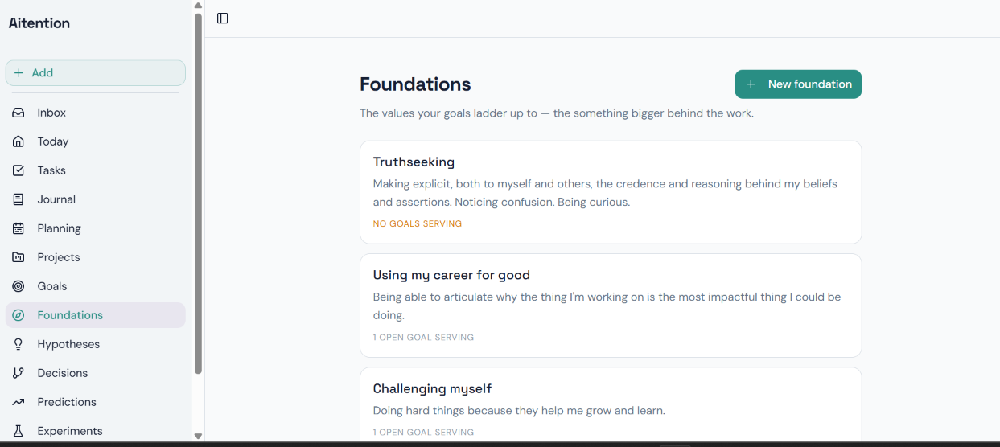
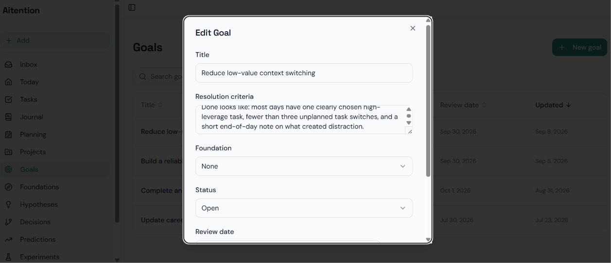
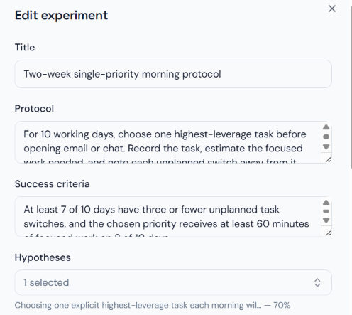
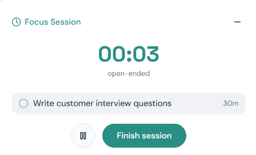
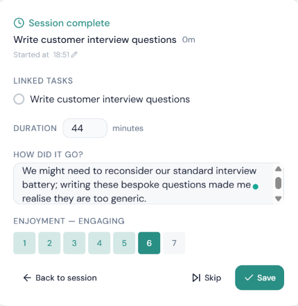
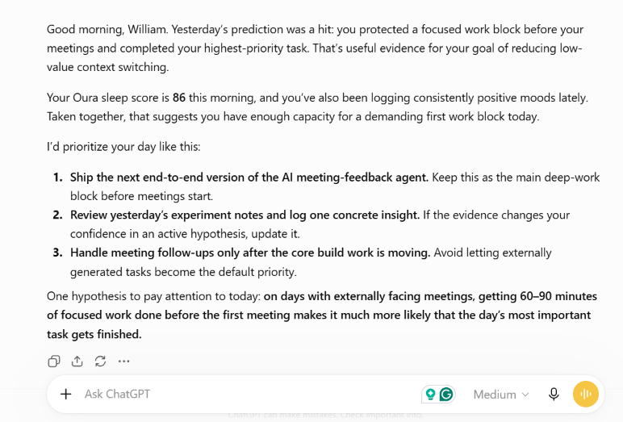

# Aitention

A personal planning app that connects daily execution with structured reflection. Organize tasks, projects and goals; run focus sessions; record decisions, hypotheses, predictions and experiments; and connect external AI assistants through MCP.

Deploy your own instance with **Supabase + Vercel**. Google OAuth is required for the current sign-in interface. **Stytch is optional:** MCP works with manually generated bearer tokens without it. Google Calendar and Oura are optional integrations.

Each installation uses its operator's own accounts and database. Screenshots below illustrate app usage. Previous deployment IDs, shared login, and migration history are excluded.

## Screenshots

Explore the app without deploying it. These screenshots show foundations, goal setting, experiments, focus sessions, session reflections, and an example assistant conversation using MCP.

### Foundations

Connect goals to the values behind them.



### Goals

Define what success looks like and when to review it.



### Experiments

Specify a protocol, success criteria, and a linked hypothesis.



### Focus sessions

Consciously focus on one task at a time with a dedicated session timer.



### Session reflection

Rate how much you enjoyed completing the task and save notes about how it went. Notes are accessible to connected LLM assistants through MCP, making reflections available for later planning and review.



### MCP assistant example

An example of an assistant response combining planning and reflection context.



## 1. Create your database

1. Create a **new Supabase project**.
2. Open the SQL Editor and run [supabase/schema.sql](supabase/schema.sql) in full.
3. Confirm success. This creates 26 empty application tables, indexes, functions, and access policies. It does not create application users or sample records.
4. Find your project URL and publishable key in the Supabase dashboard. The frontend accepts a publishable key or legacy anon key. Never use the service-role key in the frontend.

The installer is for a fresh project, not an upgrade to an existing database. Run it once; it is transactional and a failed installation rolls back. There is no historical migration chain to replay. Future releases must provide explicit upgrade instructions; do not rerun the installer to upgrade.

Upgrading an existing installation: run each script in [supabase/upgrades](supabase/upgrades) that postdates your install, in numeric order, once. `001_remove_priority_require_scheduled_date.sql` removes task priority and requires a scheduled date on every task; tasks that had none (the former Inbox) are scheduled for the current date.

## 2. Configure sign-in

1. Create a Google Cloud OAuth application and configure its consent screen.
2. Create a Web application OAuth client.
3. In Supabase Authentication, enable the Google provider. Copy its callback URL into the Google client's authorized redirect URIs. Enter the Google client ID and secret in Supabase, not in this repository.
4. While Google consent is in testing mode, add the Google accounts that will test your app as test users.
5. Configure Supabase Auth's Site URL and redirect allowlist with the final Vercel deployment URL after deployment. For local development, also allow `http://localhost:8080`.

Basic sign-in does not request Calendar access unless you enable the optional Calendar flag below. Supabase's signup/provider settings determine who may create an account on your installation; review them before sharing its URL.

## 3. Deploy the frontend on Vercel

1. Put this clean source in your own Git repository and import it into Vercel.
2. Select the **Vite** preset. Use repository root, install command `npm ci`, build command `npm run build`, and output directory `dist`.
3. Add these frontend environment variables:

   | Variable | Value |
   | --- | --- |
   | `VITE_SUPABASE_URL` | Your Supabase project URL |
   | `VITE_SUPABASE_PUBLISHABLE_KEY` | Your publishable or legacy anon key |

4. Deploy, then add the exact deployment URL to the Supabase Auth settings described above. Test Google sign-in.
5. Create a task, refresh the page, and confirm it remains saved. Open `/tasks` directly to verify routing.

`vercel.json` provides the React route fallback. Changing a `VITE_` variable requires a new build. All `VITE_` values become visible in the browser. Configure preview deployments separately; do not point untrusted previews at a database containing real records.

### Local development

Use Node.js 22 or newer and npm. Run `npm ci`, create an ignored `.env.local` with the same two frontend variables, then run `npm run dev` and open port 8080. No credentials are supplied. An unconfigured build displays setup instructions.

## 4. Optional MCP access

The MCP server runs as a Supabase Edge Function, independently of the website. It supports tool discovery, reads and writes, resources, and JSON responses over HTTP.

1. Install the Supabase CLI and authenticate it with your own account.
2. In your project's Edge Function secrets, set `MCP_ENABLED=true`.
3. Deploy the function to your project:

   ```sh
   supabase functions deploy mcp --project-ref YOUR_PROJECT_REF
   ```

   The included `supabase/config.toml` disables the gateway JWT check for this function because the handler verifies MCP credentials itself.
4. Set `VITE_ENABLE_MCP=true` in Vercel and redeploy the frontend.
5. Sign in, open **Settings > External access (MCP)**, and create a token. Copy it when shown; only its hash is retained in the database.
6. Configure a client supporting remote MCP with custom bearer authentication:

   ```text
   URL: https://YOUR_PROJECT_REF.supabase.co/functions/v1/mcp
   Authorization: Bearer YOUR_TOKEN
   ```

   Exact client configuration varies. Use its supported URL/header settings. A URL alone does not authenticate a manual-token connection.
7. Ask the client to list tools, then read a synthetic task. Revoke the token in Settings when no longer needed.

Tokens currently have account-wide access to the exposed read and write tools and remain valid until revoked. There are no separate read-only tokens or server-side confirmations. The client may offer approval controls. Never put an MCP token into frontend configuration, screenshots, source control, or a public example.

## 5. Optional integrations

### MCP OAuth through Stytch

Use this for clients that connect through a browser authorization flow rather than accepting a manually configured bearer token. Manual-token access remains available.

1. Configure Stytch Connected Apps for your deployment and its authorization server domain.
2. Set the consent/authorization UI URL to `https://YOUR_APP/oauth/authorize`.
3. Create a Trusted Auth Token profile validating JWTs from **your** Supabase project (issuer and signing keys), mapping the verified Supabase user ID to the linked Stytch user.
4. Configure the access-token template to supply `external_user_id` or `supabase_uid` containing that verified Supabase user ID. Do not let clients choose this identity.
5. Configure each Stytch Connected App to include your canonical MCP URL in `access_token_custom_audience`. This must exactly match the resource URL advertised by the MCP server (normally `https://YOUR_PROJECT.supabase.co/functions/v1/mcp`). Dynamically registered clients also need this audience configured through your provider provisioning process; OAuth access fails closed without it.
6. Set Edge Function secret `STYTCH_DOMAIN` to your authorization server's issuer URL. Keep `MCP_ENABLED=true`.
7. Set frontend variables `VITE_STYTCH_PUBLIC_TOKEN` and `VITE_STYTCH_TRUSTED_TOKEN_PROFILE_ID`, then redeploy.
8. Allow the appropriate application redirects in Supabase and Stytch. Test with the intended MCP client: it should discover Stytch after an unauthenticated request, display consent, and authenticate subsequent tool calls.

The server derives its public MCP endpoint from `SUPABASE_URL`; optional Edge Function secret `MCP_PUBLIC_URL` overrides it for a custom gateway. The verifier requires an RS256 signature, matching issuer and resource audience, expiry, issued-at, subject, OAuth client ID, and a valid linked Supabase UUID. Conflicting identity claims are rejected. OAuth grants full access to the linked account; per-tool scopes are not implemented. Run `deno test supabase/functions/mcp/verifyMcpToken.test.ts` for local signed-token regression tests. Live provider configuration must be verified in your own accounts.

### Google Calendar

1. Enable Google Calendar API for the Google OAuth project and configure its read-only consent scope.
2. Set frontend `VITE_ENABLE_GOOGLE_CALENDAR=true` and redeploy.
3. Set Edge Function secret `ALLOWED_ORIGINS` to a comma-separated list of exact frontend origins, for example `https://YOUR_APP.vercel.app,http://localhost:8080` (no trailing slashes).
4. Deploy `google-calendar` with `--project-ref YOUR_PROJECT_REF`.
5. Sign out and sign back in to grant the additional permission.

Calendar tokens can expire independently of the app session; reconnecting may be necessary. The current implementation reads the primary calendar's events.

### Oura

1. Create an Oura OAuth application and register the exact `https://YOUR_APP/auth/oura/callback` redirect.
2. Set frontend `VITE_OURA_CLIENT_ID` and redeploy.
3. Set Edge Function secrets `OURA_CLIENT_ID`, `OURA_CLIENT_SECRET`, and `ALLOWED_ORIGINS` as above.
4. Deploy `oura-oauth-callback` and `oura-sync` with `--project-ref YOUR_PROJECT_REF`.
5. Connect from Settings and verify a sync.

Supabase supplies `SUPABASE_URL`, `SUPABASE_ANON_KEY`, and `SUPABASE_SERVICE_ROLE_KEY` to hosted functions. All four function configurations are included. Deploying the frontend does not deploy functions or install the schema.

## Architecture and code tour

```text
React components -> hooks/cache -> browser services -> Supabase API -> PostgreSQL
External AI client -> MCP function -> authenticated tool handler -> PostgreSQL
```

The frontend uses React, TypeScript, Vite, TanStack Query, React Router, Tailwind CSS, and shadcn/ui. Supabase provides Auth, Postgres, and Edge Functions. This application does not require an AI-provider key; MCP clients supply their own AI capability.

| Area | Entry point |
| --- | --- |
| Routes and account-scoped cache | [src/App.tsx](src/App.tsx) |
| Authentication | [src/hooks/useAuth.ts](src/hooks/useAuth.ts) |
| Tasks and optimistic updates | [useTasks.ts](src/hooks/useTasks.ts), [taskService.ts](src/services/taskService.ts) |
| Focus-session lifecycle | [FocusSessionContext.tsx](src/contexts/FocusSessionContext.tsx) |
| MCP transport and tools | [mcp/index.ts](supabase/functions/mcp/index.ts) |
| MCP access controls | [auth.ts](supabase/functions/mcp/auth.ts), [scopedClient.ts](supabase/functions/mcp/scopedClient.ts) |
| Fresh-install schema | [supabase/schema.sql](supabase/schema.sql) |

Browser requests rely on RLS. Privileged MCP queries bypass RLS: the wrapper filters root records by verified user ID, and compound foreign keys enforce ownership of related records in the database. Account switches reset the frontend's cache, shared UI state, and pending toast actions.

## Verification

```sh
npm test
npm run test:schema
npm run build
npm run typecheck
npm run lint
```

The schema check creates in-memory PostgreSQL with synthetic auth scaffolding. It verifies a fresh install, empty tables, RLS, cross-account denial, privileged relationship checks, and delete behavior. It does not connect to any deployed database or validate Supabase's HTTP gateway/provider configuration.

See [known limitations](docs/known-limitations.md) for remaining engineering work and a deployment smoke-test checklist. Privacy and usage pages are operator-facing placeholders; provide appropriate notices and contact details before accepting other users' data.

## Licence

Licensed under the [MIT License](LICENSE). Copyright (c) 2026 William Vikatmaa. Third-party dependencies retain their respective licences.
